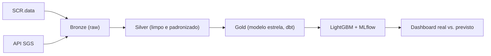

# Monitor de Risco de Crédito

Pipeline de dados ponta a ponta que monitora e prevê a inadimplência do crédito no Brasil a partir de dados públicos do Banco Central. Coleta o SCR.data e as séries macroeconômicas da API SGS, organiza tudo em camadas Medallion (bronze, silver e gold), treina um modelo de previsão e mostra real vs. previsto em um dashboard.

## Arquitetura (rascunho)

## Stack

| Camada | Ferramenta |
|---|---|
| Plataforma | Databricks Free Edition |
| Processamento | PySpark + Delta Lake |
| Transformação e modelagem | dbt (dbt-databricks) |
| Orquestração | Databricks Workflows |
| ML e tracking | LightGBM + MLflow |
| Dashboard | Databricks AI/BI |
| Qualidade e testes | dbt tests + pytest |
| Engenharia de software | Git/GitHub, Docker, GitHub Actions |

## Status

- [x] Semana 0: ambiente e repositório
- [ ] Semana 1: ingestão (bronze)
- [ ] Semana 2: silver com PySpark e Delta Lake
- [ ] Semana 3: gold, modelo estrela com dbt
- [ ] Semana 4: orquestração e carga incremental
- [ ] Semana 5: modelo de previsão com MLflow
- [ ] Semana 6: previsões em produção e dashboard
- [ ] Semanas 7–8: CI/CD, testes, README final e certificação

## Diário de bordo

| Semana | O que fiz | O que aprendi | O que travou |
|---|---|---|---|
| 0 | | | |
